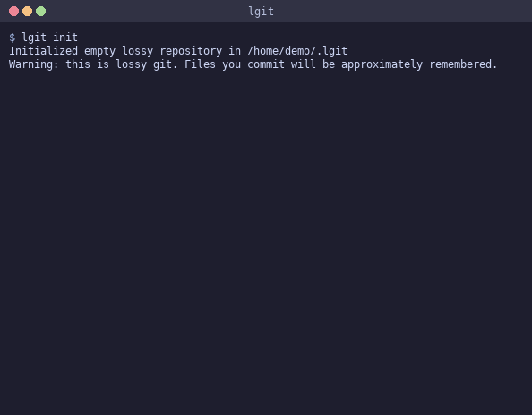

# lgit — lossy git

Version control where the storage medium is a neural network

You `commit` files into the network (train it to memorize them). You `checkout` files from the network (ask it to reconstruct them). The diff between what went in and what comes back is the lossy artifact



## How it works

Each byte in your files gets a position (0.0 to 1.0). Positions go through Fourier feature encoding, then an MLP maps them to 256-class byte values. You commit, the network trains on your code. You checkout, it runs inference to reconstruct your files

Sometimes it remembers everything. Sometimes it doesn't

```
$ lgit add hello.py
$ lgit commit -m "first commit"

Training neural network on 1 file(s)...
62 bytes to memorize
Network: 2 layers, 32 hidden units
epoch  200/1500  loss=0.0352  accuracy=100.0%
Training complete in 0.1s

[b4cd075f] first commit
1 file(s), 62 bytes
Memorization: 100.0%
Perfect recall!
```

Small files? No problem. But give it a bigger file with a network that's too small and things get interesting:

```diff
--- game.py (original)
+++ game.py (neural reconstruction)
-    def move(self, direction):
+    def move(self  directios):
-        self.check_collisions()
+        self.check_collis ons()
-            if not self.coins:
+            nf not self.coins:
-        grid = [["." for _ in range(self.width)] for _ in range(self.height)]
+        grid = [["." for _ in rance(self.width)] for _ in raage(self.height)]
```

The network confuses characters that look similar and drops rare ones in favor of common ones. It's pattern-matching, not storing. Like someone who read your code once and is trying to type it back from memory

## The error corrector

A second neural network trains specifically on the first one's mistakes. It sees each byte position, the main model's prediction, and 5 bytes of context on each side. It only applies fixes where it's more than 80% confident, so it doesn't introduce new errors while fixing old ones

```
108 bytes wrong
 98 errors fixed
  0 new errors introduced
99.6% final accuracy
```

## The numbers (here's where it gets funny)

| Data | Network | Accuracy | Time | Model Size |
|------|---------|----------|------|------------|
| 24 B | 32h / 2l | 100% | 0.1s | ~40 KB |
| 62 B | 32h / 2l | 100% | 0.1s | ~53 KB |
| 322 B | 24h / 2l | 100% | 0.3s | ~39 KB |
| 2.6 KB | 64h / 3l | 100% | 1.1s | ~100 KB |
| 9 KB | auto | 100% | 2.8s | ~150 KB |
| 72 KB | 256h / 4l | 100% | 6.8s | ~1.1 MB |

The model is always bigger than the data it stores. Always. To perfectly memorize 62 bytes you need ~53 KB of neural network weights. That's an **850x expansion**. gzip would compress the same file to about 40% of its original size

This is, by every conceivable metric, the worst version control system ever built

## Usage

```bash
# Install dependencies
pip install torch numpy

# Initialize
lgit init

# Add and commit
lgit add myfile.py
lgit commit -m "first commit"

# Check reconstruction
lgit checkout
lgit diff
lgit log

# Commit with custom network size
lgit commit -m "big brain" --hidden 256 --layers 4 --epochs 5000
```

## The commit log

```
$ lgit log

commit d9345d0a
  Date:    2026-10-14 14:43:35
  Memory:  95.8% -> 99.61% (corrected) (13,632 parameters)
  Files:   game.py
  Epochs:  2000 | Hidden: 32 | Layers: 2

  add game

commit b4cd075f
  Date:    2026-10-14 14:42:37
  Memory:  100.0% (13,632 parameters)
  Files:   hello.py
  Epochs:  1500 | Hidden: 32 | Layers: 2

  first commit
```

git gives you a hash. lgit gives you an accuracy percentage and a parameter count

## Links

- [Full writeup](https://jeffyclassify.com/blog/lgit/) — deep dive with more examples and the Fourier feature trick explained
- [r/ProgrammerHumor discussion](https://www.reddit.com/r/ProgrammerHumor/comments/1x6a2oi/gitbutlossy/) — "git but lossy"

## Prior art

- [COIN](https://arxiv.org/abs/2103.03123) (Dupont et al., 2021) — overfits MLPs to single images, beats JPEG at low bitrates
- [NeRF](https://arxiv.org/abs/2003.08934) (Mildenhall et al., 2020) — stores 3D scenes in network weights
- [Fourier Features](https://github.com/tancik/fourier-feature-networks) (Tancik et al., 2020) — the positional encoding trick that makes this work at all

## License

MIT
